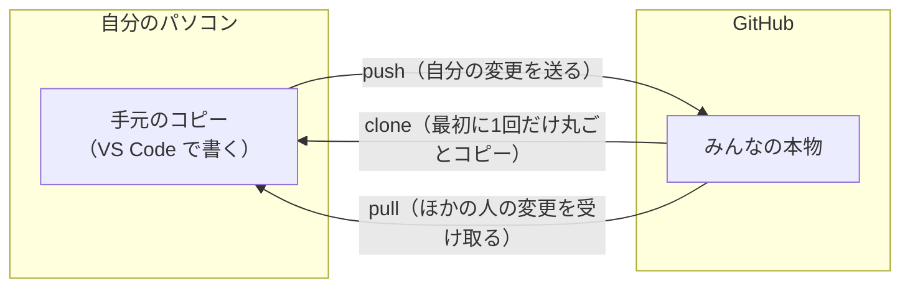
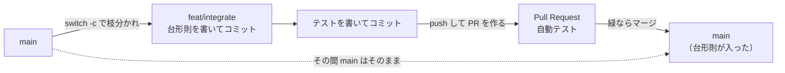

# VS Code で開発する

自分のパソコンにリポジトリを `git clone` し、VS Code で書いて、テストして、Pull Request を出すまでの手順です。

ブラウザだけで進めたい人は [開発マニュアル](MANUAL.md) を見てください。どちらの方法でも、できあがるもの（ブランチ → PR → マージ）は同じです。

---

## 全体の流れ

**最初の1回だけ**：1. GitHub に参加 → 2. Git・Python・VS Code を入れる → 3. 名前とメールを設定 → 4. clone して VS Code で開く → 5. 仮想環境を作る

**モジュールを作るたびに**：6. ブランチを作る → 7. 書く → 8. テスト → 9. コミット・push → 10. Pull Request → 自分でマージ → 11. `main` に戻す

Git をはじめて使う人は、先に次の「Git のしくみ」を読んでください。手順の中の言葉の意味が分かります。

---

## Git のしくみ（はじめに読む）

### コードは2か所にある

Git で開発するときは、同じコードが **自分のパソコン** と **GitHub** の2か所にあります。

- 自分のパソコンのコピーは、ほかの人には見えません。自由に書いたり壊したりしてかまいません。
- GitHub にあるものは、グループ全員が見られる「本物」です。

この2か所の間でコードを送ったり受け取ったりするのが、`push`（送る）と `pull`（受け取る）です。



### ブランチは「自分専用の作業場所」

みんなが使う本体を **`main`** と呼びます。`main` を直接書き換えると、書きかけのコードで他の人が困るかもしれません。

そこで、`main` から枝分かれした **ブランチ**（branch ＝ 枝）を作り、その中で書きます。ブランチの中なら、何を書いても `main` には影響しません。できあがったら **Pull Request** を出し、自動テストが通ったら `main` に **マージ**（合流）します。



### 言葉の一覧

| 言葉 | たとえると | 何をするか |
|---|---|---|
| リポジトリ | プロジェクトのフォルダ | コード一式と、その変更の記録をまとめたもの |
| `clone`（クローン） | 丸ごとダウンロード | GitHub のリポジトリを、自分のパソコンにコピーする。最初に1回だけ |
| ブランチ | 自分専用の下書き用紙 | `main` から分かれた作業場所。名前は `feat/integrate` のように付ける |
| `switch`（スイッチ） | 下書き用紙を持ち替える | いま作業するブランチを切り替える。`-c` を付けると「新しく作って切り替える」 |
| コミット | セーブポイント | 「ここまでできた」という変更をひとまとまりにして、手元に記録する。まだ GitHub には送られない |
| `push`（プッシュ） | アップロード | 手元のコミットを GitHub に送る |
| `pull`（プル） | ダウンロードして取り込む | GitHub にあるほかの人の変更を、手元に取り込む |
| Pull Request（PR） | 「本体に入れてください」という申請書 | 自分のブランチを `main` に入れる申し込み。ここで自動テストが走る |
| CI（自動テスト） | 自動の検査係 | PR を出すたびに、GitHub がテストを Python 3.10〜3.13 で実行する |
| マージ | 本体に合流させる | PR の変更を `main` に入れる。テストが緑のときだけできる |

**よくある勘違い**：`push` しただけでは Pull Request はできません。`push` は「ブランチを GitHub に送る」だけです。そのあと GitHub の画面で **Create pull request** を押して、はじめて PR になります（手順 10）。

---

## 1. GitHub に参加する

[開発マニュアルの手順 1・2](MANUAL.md#1-github-のアカウントを作る) のとおり、アカウントを作り、グループ `NumericalAnalysisClass` の招待を承認してください。承認しないと push できません。

## 2. Git・Python・VS Code を入れる

| もの | Mac | Windows |
|---|---|---|
| Git | ターミナルで `xcode-select --install` | https://git-scm.com/download/win （設定はすべて既定のままで OK） |
| Python 3.10 以上 | https://www.python.org/downloads/ | https://www.python.org/downloads/ （最初の画面で **Add python.exe to PATH** にチェック） |
| VS Code | https://code.visualstudio.com/ | 同じ |

VS Code を開いたら、左の四角が4つ並んだアイコン（拡張機能）で **Python**（Microsoft 製）を検索してインストールします。

入ったかどうかは、ターミナル（Windows は PowerShell）で確かめます。

```bash
git --version
python3 --version     # Windows は  python --version
```

## 3. コミットに載る名前とメールを設定する

コミットには名前とメールアドレスが記録され、**だれでも見られる形で公開されます**。本名や普段のメールを出したくない人は、GitHub が用意する非公開用のアドレスを使います。

1. GitHub の右上のアイコン → **Settings** → **Emails** を開く
2. **Keep my email addresses private** をオンにする
3. その下に出る `12345678+ユーザー名@users.noreply.github.com` をコピーする
4. ターミナルで設定する

```bash
git config --global user.name "GitHubのユーザー名"
git config --global user.email "12345678+ユーザー名@users.noreply.github.com"
```

## 4. clone して VS Code で開く

clone に使う URL は次のものです（右上のボタンでコピーできます）。

```
https://github.com/NumericalAnalysisClass/numerical-analysis-team.git
```

この URL は、[リポジトリのページ](https://github.com/NumericalAnalysisClass/numerical-analysis-team) の緑の **<> Code** ボタン → **HTTPS** タブでも確かめられます。

1. VS Code で `Cmd+Shift+P`（Windows は `Ctrl+Shift+P`）を押し、`Git: Clone` と打って選ぶ
2. 入力欄に上の URL を貼り付けて Enter を押す
3. 保存先を選ぶ（例：書類フォルダ）。選んだ場所の中に `numerical-analysis-team` フォルダが作られます
4. 「開きますか？」と聞かれたら **開く** を押す

途中で **GitHub にサインイン** を求められたら、ブラウザで許可します。これで、VS Code から（VS Code の中のターミナルからも）push できるようになります。

ターミナルでやる場合は次のとおりです。

```bash
git clone https://github.com/NumericalAnalysisClass/numerical-analysis-team.git
code numerical-analysis-team     # code コマンドが無ければ VS Code の「ファイル」→「フォルダーを開く」
```

## 5. 仮想環境を作り、パッケージを入れる

VS Code のメニュー **ターミナル** → **新しいターミナル** を開きます。画面の下に出るターミナルは、すでにリポジトリのフォルダにいます。

**Mac**

```bash
python3 -m venv .venv
source .venv/bin/activate
pip install -e ".[dev]"
pytest
```

**Windows（PowerShell）**

```powershell
python -m venv .venv
.venv\Scripts\Activate.ps1
pip install -e ".[dev]"
pytest
```

最後に `passed` とだけ出れば準備完了です。

- `.venv` は自分専用の Python の置き場所です。`.gitignore` に入っているので GitHub には上がりません。
- `-e` を付けて入れると、`src/` のファイルを書き換えた内容がそのまま `import` に反映されます。
- 行の先頭に `(.venv)` が付いていれば、仮想環境に入っています。新しいターミナルを開くたびに `activate` の行をもう一度実行します。

最後に VS Code にこの仮想環境を使わせます。`Cmd+Shift+P` → `Python: Select Interpreter` → `.venv` と書かれたものを選びます。

---

## 6. ブランチを作る

ここからは、モジュールを作るたびに行います。例として `integrate`（数値積分）を作ります。先に Issue を立てておきます（[開発マニュアルの手順 3](MANUAL.md#3-作るものを決めて-issue-を立てる)）。

```bash
git switch main
git pull                         # ほかの人のマージ分を取り込む
git switch -c feat/integrate     # feat/ + モジュール名
```

それぞれの行の意味は次のとおりです。

1. `git switch main`：本体の `main` に移る
2. `git pull`：GitHub から最新の `main` を受け取る。ほかの人がマージしたコードが手元に入る
3. `git switch -c feat/integrate`：最新の `main` から自分のブランチを新しく作り、そこに移る

VS Code の左下にブランチ名が出ます。**`main` のまま書き始めないでください。** `main` には PR を通してしか入れられません。

- ブランチは最初の1回だけ作ります。同じ名前でもう一度 `git switch -c` を打つと「もうある（already exists）」と言われます。
- 作ってあるブランチに戻るだけなら、`-c` を付けずに `git switch feat/integrate` と打ちます。
- VS Code では、左下のブランチ名を押すと、ブランチの作成や切り替えができます。

## 7. 書く

左のエクスプローラーで `src/numerical_analysis_team/` を右クリック → **新しいファイル** → `integrate.py` を作ります。

書き方の約束（先頭に手法と授業の回、docstring に式と収束の性質、依存は NumPy だけ、など）は [開発マニュアルの「書き方の約束」](MANUAL.md#書き方の約束) を見てください。見本は [`roots.py`](../src/numerical_analysis_team/roots.py) と [`pde.py`](../src/numerical_analysis_team/pde.py) です。

**自分のファイル以外（`__init__.py`・`pyproject.toml`・ほかの人のファイル）は変えません。**

## 8. テストする

`tests/test_integrate.py` を作り、`test_` で始まる関数を書きます。何を確かめるかは [開発マニュアルの手順 6](MANUAL.md#6-テストを書く) にあります。

```bash
pytest                              # 全部
pytest tests/test_integrate.py -v   # 自分のだけ、関数ごとに結果を表示
```

`FAILED` が出たら、その下の `assert` の行と値を読んで直します。左のフラスコのアイコン（テスト）からも実行できます。

ちょっと動かしてみたいときは、ターミナルで `python` を起動します。

```python
>>> import math
>>> from numerical_analysis_team import integrate
>>> integrate.trapezoid(math.sin, 0, math.pi)
```

## 9. コミットして push する

**VS Code で**

1. 左の枝分かれのアイコン（ソース管理）を開く
2. 「変更」に出たファイルのうち、**自分が作ったものだけ** `+` を押して「ステージ」に移す
3. 上の欄にメッセージ（例：`integrate: 台形則を追加`）を書いて **コミット**
4. **Branch の発行**（2回目からは **変更の同期**）を押す

**ターミナルで**

```bash
git status
git add src/numerical_analysis_team/integrate.py tests/test_integrate.py
git commit -m "integrate: 台形則を追加"
git push -u origin feat/integrate      # 2回目からは git push だけ
```

それぞれの行の意味は次のとおりです。

1. `git status`：変えたファイル・新しく作ったファイルの一覧を見る
2. `git add ファイル名`：次のコミットに入れるファイルを選ぶ（「ステージ」に載せる）
3. `git commit -m "メッセージ"`：選んだファイルの変更を、メッセージ付きで手元に記録する（セーブポイント）
4. `git push -u origin ブランチ名`：手元のコミットを GitHub に送る。`origin` は GitHub のリポジトリのこと。`-u` は「このブランチは GitHub のこのブランチとつながっている」と覚えさせる指定で、2回目からは `git push` だけで済むようになる

`git add .` でまとめて足さず、ファイルを選んでください。メモやノートブックがうっかり公開されるのを防ぐためです。

`commit` と `push` は別々のコマンドです。`git commit -u origin ...` のように混ぜるとエラーになります。

push すると、ターミナルに次のような表示が出ます。

```
remote: Create a pull request for 'feat/integrate' on GitHub by visiting:
remote:      https://github.com/NumericalAnalysisClass/numerical-analysis-team/pull/new/feat/integrate
```

この URL は「PR を作る画面」へのリンクです。**この時点では、まだ PR はできていません**（次の手順 10 で作ります）。

## 10. Pull Request を出してマージする

PR を作る画面は、次のどれからでも開けます。

- push したときにターミナルに出た URL（手順 9）を開く
- [リポジトリのページ](https://github.com/NumericalAnalysisClass/numerical-analysis-team) の上に出る黄色い帯の **Compare & pull request** を押す（push してから1時間ほど出ます）
- [Pull requests](https://github.com/NumericalAnalysisClass/numerical-analysis-team/pulls) タブ → **New pull request** → `compare:` で自分のブランチを選ぶ

**Pull requests タブには、作り終えた PR だけが並びます。** push しただけのブランチは出てきません。

画面が開いたら、次のように進めます。詳しい画面の説明は [開発マニュアルの手順 8〜9](MANUAL.md#8-pull-request-を出す) にあります。

1. タイトル（例：`integrate: 台形則を追加`）と本文を書く。本文の `Closes #` の後ろに Issue の番号を入れ、チェック項目を確かめて `[x]` にする
2. **Create pull request** を押す。ここで PR ができ、Pull requests タブに並びます
3. 自動テスト（`pytest (3.10)`〜`pytest (3.13)`）が4つとも緑の ✓ になるのを待つ（1分ほど）
4. 赤い × が出たら、手元で直してコミット → `git push`。同じ PR に自動で反映され、もう一度テストされます（PR を作り直す必要はありません）
5. 緑になったら **Merge pull request** → **Confirm merge** を押す。これで `main` に入ります
6. **Delete branch** を押して、GitHub 上の使い終わったブランチを消す

## 11. main に戻す

```bash
git switch main
git pull
git branch -d feat/integrate
```

それぞれの行の意味は次のとおりです。

1. `git switch main`：本体の `main` に戻る
2. `git pull`：自分の PR をマージした後の `main` を GitHub から受け取る。手元の `main` は自動では新しくならないので、ここで取り込む
3. `git branch -d feat/integrate`：手元に残った使い終わったブランチを消す（中身はもう `main` に入っています）

次のモジュールは、手順 6 から始めます。マージしたコードは、すぐ Colab で使えます（[開発マニュアルの手順 10](MANUAL.md#10-マージしたらすぐ使う)）。PyPI への公開は企画者が行います。

---

## 困ったとき

| こんなとき | 原因と対処 |
|---|---|
| push で `403` や `Permission denied` | グループの招待をまだ承認していません（手順 1）。承認済みなら、VS Code の左下の人のアイコンからサインインし直します |
| push でユーザー名とパスワードを聞かれる（Mac のターミナル） | VS Code の中のターミナルか、ソース管理の画面から push します。外のターミナルを使いたい人は [GitHub CLI](https://cli.github.com/) を入れて `gh auth login` を一度実行します |
| Windows で `python` が見つからない | Python のインストールで **Add python.exe to PATH** を付け忘れています。入れ直すか、`python` の代わりに `py` を使います |
| Windows で `Activate.ps1` が「スクリプトの実行が無効」で止まる | PowerShell で `Set-ExecutionPolicy -Scope CurrentUser RemoteSigned` を一度実行します |
| `ModuleNotFoundError: No module named 'numerical_analysis_team'` | 仮想環境に入っていません。`activate` の行を実行し、VS Code では `Python: Select Interpreter` で `.venv` を選びます |
| VS Code のエディタで `import` に波線が出る | 同上（インタープリターが `.venv` になっていない） |
| `main` でコミットしてしまった（push 前） | `git switch -c feat/モジュール名` でそのままブランチにします。続けて `git branch -f main origin/main` で `main` を元に戻します |
| PR に「This branch has conflicts」 | `git switch main && git pull && git switch feat/モジュール名 && git merge main` を実行します。VS Code が食い違う箇所を色分けで出すので、残したいほうを選び、保存してコミット → push します |
| コミットのメールアドレスを間違えた（push 前） | 手順 3 で設定し直してから `git commit --amend --reset-author --no-edit` を実行します |

分からなければ、Issue か PR のコメントで気軽に質問してください。
